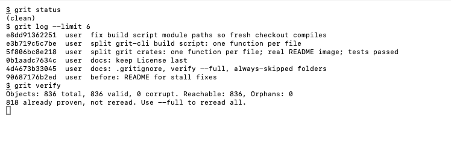

# Grit

**Local-first, content-addressed version control built for safe automation.**

Grit snapshots a project folder into an immutable, verified store in `.grit/`.
It was built for one job Git handles badly: letting scripts and AI coding
agents change files freely, with a guaranteed way back.

Grit coexists with Git. It never reads, converts, or replaces `.git`.



> **Status:** `0.1.0`, storage foundation. This README describes only what the
> current binary does. Planned work (Lanes, Grains, Reviews, Receipts, Forge
> Protocol) is specified in [FUTURE.md](FUTURE.md) and is not shipped.

---

## Why

| Problem with Git for automation | What Grit does |
|---|---|
| `git checkout` / `reset --hard` silently drops uncommitted work | `restore` over changed files requires `--force`, takes a safety snapshot first, and keeps displaced files in `.grit/tmp/restore-backups` (`undo` is the explicit fast path: forced, no safety snapshot) |
| Staging area, HEAD, detached state are easy for a script to get wrong | One step: `grit snapshot` saves the whole tree |
| Corruption is found late, if at all | Every object is BLAKE3-addressed; `grit verify --full` re-hashes the store |
| Partial writes after a crash | Refs and restored files are written atomically |

## What a snapshot preserves

Exact file bytes, executable modes, symbolic links, empty directories,
renames, and deletions.

Objects are immutable, BLAKE3-hashed, and zstd-compressed (level 3).

## Quick start

```bash
cd my-project
grit init
grit snapshot -m "before agent run"

# … let a script or agent edit files …

grit status                      # what changed since last snapshot
grit diff                        # changes vs last snapshot
grit restore SNAPSHOT --force    # roll back; safety snapshot taken first
grit verify                      # check objects changed since last proven; --full rereads all
```

## Commands

| Command | Purpose |
|---|---|
| `init` | create `.grit/` in current folder |
| `snapshot` | save working tree (`-m` message, `--path` for partial) |
| `status` | changes since last snapshot |
| `diff` | working tree vs last snapshot, or `diff A B` between two snapshots |
| `log` | snapshot history (`--limit`) |
| `show` | one snapshot's details |
| `restore` | restore a snapshot (`--force`, `--no-safety-save`, `--path`) |
| `undo` | restore previous snapshot in journal (forced, **no** safety snapshot) |
| `checkout` / `branch` / `tag` | transitional Git-shaped helpers |
| `verify` | check objects not yet proven; `--full` rereads every object |
| `gc` | verify store, then move unreachable objects to `.grit/tmp/gc-trash/` (refuses if corrupt) |
| `doctor` | print repo state: store, HEAD, branch, latest snapshot |

Shared options:

| Option | Effect |
|---|---|
| `--format toml` | machine-readable report (schema: [docs/output-schema.toml](docs/output-schema.toml)) |
| `--path PATH` | repeatable; limit snapshot / restore / status to paths |
| `--repo DIR`, `-C DIR` | operate on another project folder |

## Defaults

From [defaults.toml](defaults.toml):

| Setting | Value |
|---|---|
| hash | `blake3` |
| compression | `zstd`, level 3 |
| excluded | `.grit/`, `.git/`, `target/`, `node_modules/`, `.DS_Store` |
| restore safety snapshot | on |
| confirm overwrite | on |

## Build

Requires a Rust toolchain.

```bash
cargo build --release -p grit-cli      # binary: target/release/grit
./build.command                        # macOS: build, smoke-test, install to ~/.local/bin/grit atomically
```

`build.command` installs a candidate binary, runs it once, then swaps it in;
any previous binary goes to `~/.Trash` instead of being overwritten.

## Layout

| Path | Holds |
|---|---|
| `crates/grit-engine/` | store, hashing, snapshot / restore logic |
| `crates/grit-cli/` | `grit` command-line front end |
| `tests/integration/` | end-to-end tests |
| `docs/future/` | design contracts for planned features |
| `FUTURE.md` | roadmap and vocabulary that will replace Git-shaped commands |

## Related

**Skill repo:** [towelWet/grit-skill](https://github.com/towelWet/grit-skill) — Claude Code skill holding design spec, AI verb layer, and storage philosophy.

## Keeping snapshots fast

List folders to skip in `.gritignore` at repo root: one pattern per line, `#` for comments.
`.build`, `.build-tmp`, `.venv`, `__pycache__`, and `node_modules` are always skipped, at any depth.
A file edited or deleted during a snapshot is saved as it was read, and never fails the snapshot.

## License

MIT. See [LICENSE](LICENSE).
